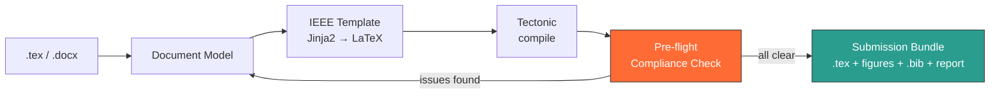
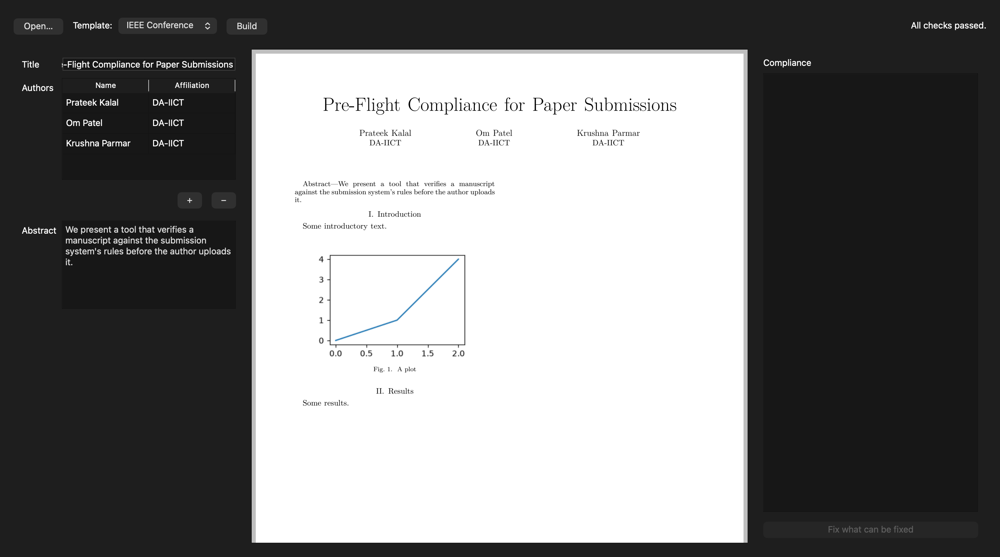
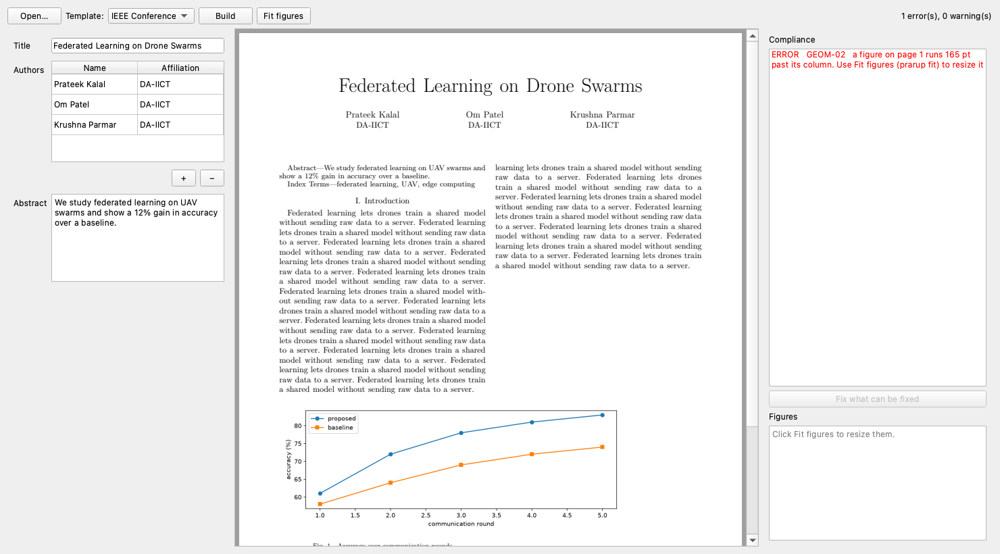
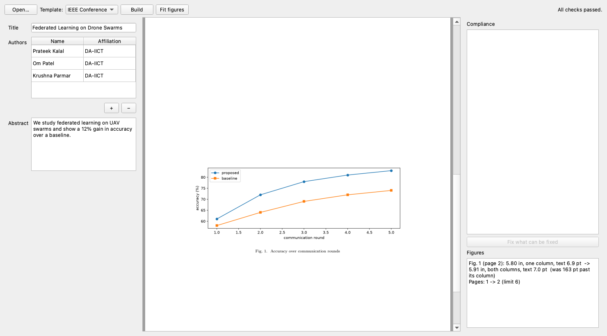

<div align="center">

# प्रारूप · Prarup

**Format-compliant research papers — before you submit.**

An offline desktop tool that converts your manuscript to a target conference
template, compiles it live, and verifies it against the submission system's
actual rules while you can still fix things.

`PC503 — Python Programming` · `DA-IICT`

</div>

---

## The one-line version

> Overleaf shows you the PDF. IEEE PDF eXpress tells you it is wrong *after* you submit.
> **Prarup tells you while you can still fix it — without your manuscript leaving your laptop.**

---

## The pipeline



---

## Why this exists

The most common reason IEEE rejects a submitted PDF is not in your `.tex` file at all.
It is a font embedded inside a **figure** — Helvetica or Arial, quietly written in by
matplotlib, MATLAB or R when you exported the plot.

You find out on deadline day, from an error message that explains nothing.

Prarup catches it in about thirty lines of PyMuPDF, before you ever open the submission portal.

There is a second, nastier variant. matplotlib's **default** export uses Type3
fonts, which are bitmap-based and rejected by IEEE **even when correctly
embedded** — and Ghostscript cannot repair them. So "fix the fonts" is really two
problems with two different answers, and a tool that does not tell them apart
will report successes it did not achieve. See
[11 · Compliance Rules](docs/11-compliance-rules.md).

---

## Documentation

| Document | What's inside |
|---|---|
| [01 · Problem & Motivation](docs/01-problem.md) | Why formatting compliance is a real, expensive problem |
| [02 · System Architecture](docs/02-architecture.md) | Full pipeline, component diagrams, data flow |
| [03 · Features](docs/03-features.md) | Table stakes vs. our differentiators |
| [04 · UI Design](docs/04-ui-design.md) | Screen layouts, click paths, mockup specs |
| [05 · Python Design](docs/05-python-design.md) | The classes and functions that exist, and why |
| [06 · Tech Stack](docs/06-tech-stack.md) | Every library, and why it was chosen |
| [07 · Scope & Timeline](docs/07-scope-and-timeline.md) | What we commit to in four weeks |
| [08 · Presentation Outline](docs/08-presentation-outline.md) | Slide-by-slide deck content |
| [09 · References](docs/09-references.md) | Sources for every claim we make |

### Build documentation

| Document | What's inside |
|---|---|
| [10 · Toolchain](docs/10-toolchain.md) | Every dependency, install commands, how Tectonic and Jinja2 are configured |
| [11 · Compliance Rules](docs/11-compliance-rules.md) | The rule catalogue — detection code, severity, and remedy for each check |
| [12 · Implementation Notes](docs/12-implementation-notes.md) | The build pipeline, the worker thread, font inspection, docx conversion details |
| [13 · Pitfalls](docs/13-pitfalls.md) | Silent failures, environment traps, demo rehearsal checklist |
| [14 · How To Build It](docs/14-how-to-build.md) | Minimal design, walking skeleton, the first ten tests, design rules |
| [15 · The Figure Fitter](docs/15-figure-fitter.md) | Fitting figures to their columns and the page limit without making their text unreadable |

---

## Team

| Name | Roll Number |
|---|---|
| Prateek Kalal | 202611009 |
| Om Patel | 202611030 |
| Krushna Parmar | 202611032 |

---

## Quick start

```bash
poetry install
poetry run python tools/make_fixtures.py     # generate test PDFs
poetry run pytest                             # 160 tests
```

External tools: `tectonic` to compile, `pandoc` for `.docx`, `ghostscript` to
repair fonts, `tesseract` to read text inside bitmap figures (optional: without it,
bitmap figures are kept inside their column but not sized for readability). On macOS:

```bash
brew install tectonic pandoc ghostscript tesseract
```

## Using it

```bash
poetry run prarup build paper.docx \
    --author "Krushna Parmar:DA-IICT" \
    --abstract "A short abstract."          # convert, template, compile, verify

poetry run prarup build paper.tex           # compile, verify
poetry run prarup check paper.pdf           # verify an existing PDF
poetry run prarup check paper.pdf --fix     # repair, then re-verify
poetry run prarup fit paper.docx            # resize figures to fit, keep their text readable
poetry run prarup-gui                       # the desktop window
```



Title, authors and abstract are **read from the Word file**: from Word's own
Title and Author styles when used, otherwise from the paragraphs above the one
starting "Abstract". The window fills its fields with what it found, and
anything typed there (or passed as `--title`, `--author`, `--abstract`) wins.

### Fitting figures

A Word figure keeps its size in inches, so a wide one runs across the second
IEEE column. **Build** reports it (GEOM-02); **Fit figures** resizes every
figure to fit its column, moves it across both columns if one column would
shrink its text below 7 pt, and shrinks figures together when the paper is over
the page limit, never below 7 pt. See [15 · The Figure Fitter](docs/15-figure-fitter.md).

| Build: the chart runs into the second column | Fit figures: across both columns, text 7.0 pt |
|---|---|
|  |  |

Try it with `tests/fixtures/demo_paper.docx`.

A `.docx` is converted to a body fragment, wrapped in the IEEE conference
template, and compiled. A `.tex` is compiled as it stands, because there is no
reliable way to separate an author's preamble from their body.

Real output on a published 13-page IEEE IoT Journal article (trimmed):

```
paper.pdf: 6 error(s), 1 warning(s)

  ERROR  FONT-01  Helvetica is not embedded (pages 1-13)   [can fix automatically]
  ERROR  FONT-02  STIXGeneral-Italic is a Type3 bitmap font (pages 9-12). Re-export the figure with matplotlib rcParams['pdf.fonttype'] = 42
  ...
  WARN   GEOM-01  7 pages over the 6-page limit
```

Exit codes: `0` nothing blocking, `1` would be rejected, `2` the tool could not
run. Usable as a gate in a submission script.

`--fix` writes a repaired copy and re-runs every check on it. It never reports a
repair it has not verified, never modifies the original, and leaves images at
their original resolution and compression.

---

## Status

**v0.9.** Working:

- `.docx` and `.tex` input, IEEE conference template, Tectonic compilation
- Title, authors, abstract and keywords read from the Word file
- **The figure fitter**: figures fitted to their columns and the page limit with
  their text kept at 7 pt or more, measured from the compiled PDF (OCR for bitmaps)
- Six compliance checks: unembedded fonts, Type3 fonts, page limit, encryption,
  bookmarks, figures past their column
- Ghostscript repair, re-checked, that leaves figures untouched
- A PySide6 window over all of it, and the same on the command line

**Tested on a real paper.** A 13-page IEEE IoT Journal article: Prarup found the
default-matplotlib Type3 fonts in its figures on pages 9 to 12, reported each
font once with its pages, and repaired the unembedded Helvetica without changing
a pixel of any figure.

**Python 3.11 to 3.13.** PySide6 publishes no wheels for 3.14 yet.

160 tests pass, GUI included, headless. Every expected number in the fitter's
tests is worked out by hand from the plot's own text size and the IEEE geometry.

Not built yet: submission bundle export, auto-compile while typing, a caption
editor, PDF/A, margin and caption-placement checks, and the LLM advisory layer. See [07 · Scope](docs/07-scope-and-timeline.md) and
[11 · Compliance Rules](docs/11-compliance-rules.md).
