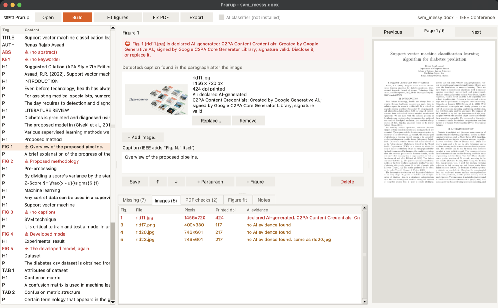
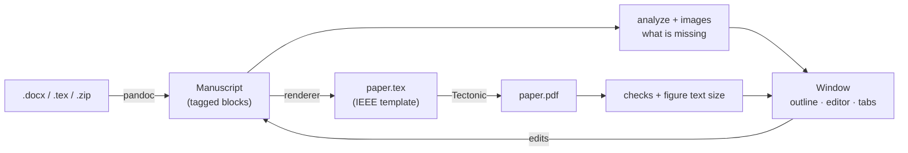

# Prarup (प्रारूप)

A desktop app that turns a research paper into an IEEE conference paper and
checks it before submission. Open a Word file, a LaTeX file or a zipped LaTeX
project; Prarup shows the paper as a tagged outline, lists what is missing,
checks every image (including evidence that it was AI-generated), and builds
the IEEE PDF next to it. Everything runs offline.

Prateek Kalal, Om Patel and Krushna Parmar built Prarup for PC503.



## What it does

- **Reads the paper** into blocks, each with a tag: TITLE, AUTH, ABS, KEY,
  H1, P, FIG 3, TAB 2, EQ, REF. Captions written in many styles are found.
- **Shows what is missing**: no abstract, no keywords, a figure without a
  caption or without its image, a citation past the end of the references.
  Rows with a problem are red with ⚠; clicking a problem opens its block.
- **Lets you fix it in place**: edit the title block, any paragraph (or
  re-tag it as a heading), captions, table cells, references; replace or add
  images; move, insert and delete blocks.
- **Checks images**: printed resolution (300 dpi for IEEE), duplicates, and
  AI evidence in three layers: a signed C2PA record, generator traces, and an
  optional classifier that runs on photos only.
- **Builds the IEEE PDF** a moment after each edit, then checks it: fonts
  embedded, page limit, figures inside their column, figure text at least 7 pt.
- **Fit figures** resizes figures until their text is readable; if that goes
  over the page limit, you choose between readable and within the limit.
- **Fix PDF** embeds missing fonts with Ghostscript. **Export** saves a zip
  with the PDF, LaTeX, images and a report.

## Run it

Python 3.11 to 3.13 **with Tkinter**, plus three programs: Pandoc (reads
papers), Tectonic (builds PDFs) and Ghostscript (Fix PDF). Tesseract is
optional and measures text inside bitmap figures.

macOS (Homebrew's Python needs `brew install python-tk@3.13` for Tkinter):

```bash
brew install pandoc tectonic ghostscript tesseract
python3 -m venv .venv
.venv/bin/pip install -r requirements.txt
.venv/bin/python -m prarup.main
```

Windows (PowerShell):

```powershell
py -m venv .venv
.\.venv\Scripts\python.exe -m pip install -r requirements.txt
.\.venv\Scripts\python.exe -m prarup.main
```

The AI classifier is optional (about 2 GB): `pip install -r requirements-ai.txt`,
then tick **AI classifier**. Try `demo/demo_word.docx`, or the damaged real
papers in `tests/fixtures/messy/`.

## How it works



The window never does the work itself: it calls `Project`, which calls the
modules. Slow jobs run on one background thread; Tkinter is not thread-safe,
so the thread only computes and the window polls for the result with
`root.after()`. Edits are saved to `<paper>-prarup/manuscript.json` at once.

## Who owns what

Each member owns 1,200 to 1,300 lines of code and the tests for them.

| Member | Responsibility | Code to own | Tests | What to demo |
|---|---|---|---|---|
| **Prateek** | Reading the paper, and image checks | `ingest.py`, `frontmatter.py`, `pandoc.py`, `texsource.py`, `manuscript.py`, `images.py` | `test_ingest`, `test_front_matter`, `test_images` | Open the Word and LaTeX demos and show the title, authors, sections, captions and images found. Open the damaged SVM paper and show the AI image with Google's signed C2PA record, the 117 dpi image and the duplicate. |
| **Krushna** | Building the IEEE PDF, and checking it | `analyze.py`, `renderer.py`, `compile.py`, `checks.py`, `fix.py`, `fit.py`, `measure.py`, `figures.py`, `models.py`, the IEEE template and rules | `test_analyze`, `test_renderer`, `test_compile`, `test_checks`, `test_fix`, `test_fit`, `test_measure`, `test_figures`, `test_models`, `test_layering` | Build the PDF and explain one finding from each tab. Show Fit figures taking a figure's text from 3.9 pt to 7 pt, and Fix PDF embedding a missing font. |
| **Om** | The Tkinter window, and joining everything | `ui/window.py`, `ui/editors.py`, `ui/outline.py`, `ui/panels.py`, `ui/preview.py`, `ui/style.py`, `project.py`, `main.py`, `process.py` | `test_window`, `test_project`, `test_messy`, `test_end_to_end` | Click a problem in Missing, fix it in the editor, watch the PDF rebuild, export the zip. Explain how the window stays responsive during a build. |

## Project layout

| Folder | Contents |
|---|---|
| `prarup/` | The code; `prarup/ui/` is the window |
| `prarup/templates/`, `prarup/presets/` | IEEE LaTeX template and rules |
| `demo/` | Small Word and LaTeX papers to try |
| `tests/` | Tests; `fixtures/real/` are three CC-BY papers, `fixtures/messy/` damaged copies |
| `tools/make_messy.py` | Makes the damaged papers, listed in `tests/fixtures/messy/README.md` |
| `docs/` | [Compliance rules](docs/compliance.md) and [figure fitting](docs/figure-fitting.md) |

## Run the tests

```bash
.venv/bin/python -m pytest
```

Tests that need a program that is not installed (Pandoc, Tectonic,
Ghostscript, the classifier) are skipped, not failed.
