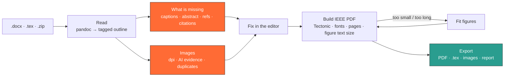
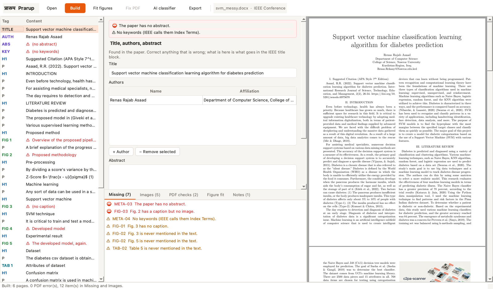
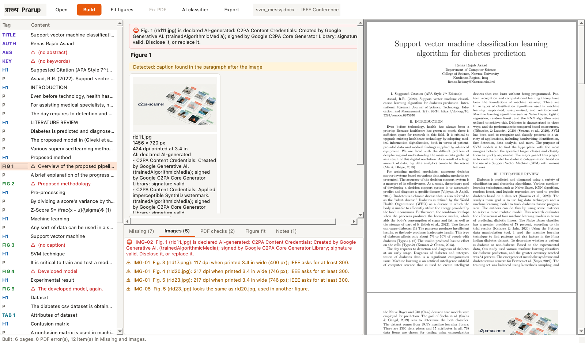
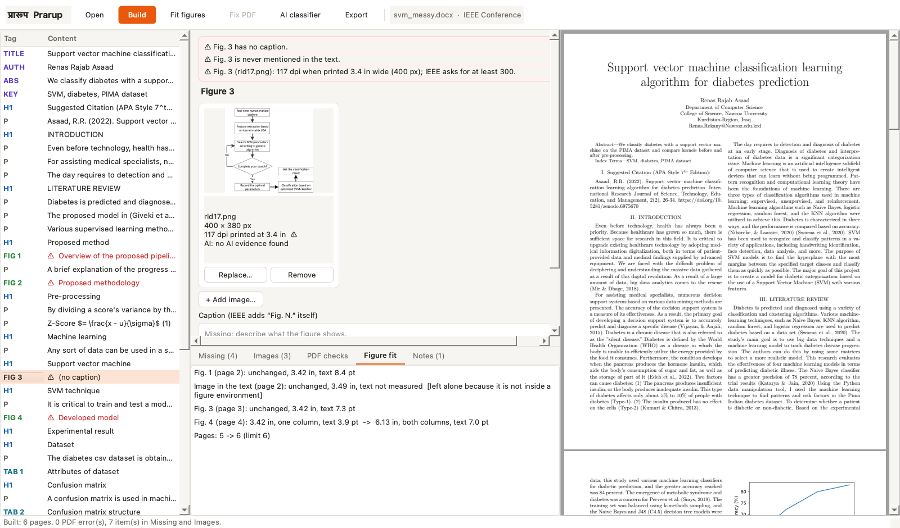

<div align="center">

# प्रारूप · Prarup

**Format-compliant research papers — before you submit.**

An offline desktop tool. Open your paper (Word or LaTeX) and Prarup shows it
as a tagged outline, lists everything that is missing, checks every image
(resolution, AI-generated, duplicates), lets you fix it in place, and builds
the IEEE conference PDF beside it, checked against the submission rules.

`PC503 — Python Programming` · `DA-IICT`

</div>

---

## The one-line version

> Overleaf shows you the PDF. IEEE PDF eXpress tells you it is wrong *after* you submit.
> **Prarup tells you while you can still fix it — without your manuscript leaving your laptop.**

---

## What it does





---

## Why this exists

The most common reason IEEE rejects a submitted PDF is not in your `.tex` file at all.
It is a font embedded inside a **figure** — Helvetica or Arial, quietly written in by
matplotlib, MATLAB or R when you exported the plot.

You find out on deadline day, from an error message that explains nothing.

Prarup catches it in about thirty lines of PyMuPDF, before you ever open the submission portal.

There is a second, nastier variant. matplotlib's **default** export uses Type3
fonts, which are bitmap-based and rejected by IEEE **even when correctly
embedded** — and Ghostscript cannot repair them. So "fix the fonts" is really two
problems with two different answers, and a tool that does not tell them apart
will report successes it did not achieve. See
[11 · Compliance Rules](docs/11-compliance-rules.md).

---

## Documentation

| Document | What's inside |
|---|---|
| [01 · Problem & Motivation](docs/01-problem.md) | Why formatting compliance is a real, expensive problem |
| [02 · System Architecture](docs/02-architecture.md) | Full pipeline, component diagrams, data flow |
| [03 · Features](docs/03-features.md) | Table stakes vs. our differentiators |
| [04 · UI Design](docs/04-ui-design.md) | Screen layouts, click paths, mockup specs |
| [05 · Python Design](docs/05-python-design.md) | The classes and functions that exist, and why |
| [06 · Tech Stack](docs/06-tech-stack.md) | Every library, and why it was chosen |
| [07 · Scope & Timeline](docs/07-scope-and-timeline.md) | What we commit to in four weeks |
| [08 · Presentation Outline](docs/08-presentation-outline.md) | Slide-by-slide deck content |
| [09 · References](docs/09-references.md) | Sources for every claim we make |

### Build documentation

| Document | What's inside |
|---|---|
| [10 · Toolchain](docs/10-toolchain.md) | Every dependency, install commands, how Tectonic and Jinja2 are configured |
| [11 · Compliance Rules](docs/11-compliance-rules.md) | The rule catalogue — detection code, severity, and remedy for each check |
| [12 · Implementation Notes](docs/12-implementation-notes.md) | The build pipeline, the worker thread, font inspection, docx conversion details |
| [13 · Pitfalls](docs/13-pitfalls.md) | Silent failures, environment traps, demo rehearsal checklist |
| [14 · How To Build It](docs/14-how-to-build.md) | Minimal design, walking skeleton, the first ten tests, design rules |
| [15 · The Figure Fitter](docs/15-figure-fitter.md) | Fitting figures to their columns and the page limit without making their text unreadable |
| [16 · Redesign](docs/16-redesign.md) | Audit on real papers, the user journey, architecture and data model diagrams |
| [17 · Testing on Real Papers](docs/17-real-world-testing.md) | Six real papers, AI-image detection measured, damaged papers fixed in the window |

---

## Team

| Name | Roll Number |
|---|---|
| Prateek Kalal | 202611009 |
| Om Patel | 202611030 |
| Krushna Parmar | 202611032 |

---

## Quick start

```bash
brew install tectonic pandoc ghostscript tesseract
poetry install                    # add --with ai for the optional AI-image classifier
poetry run prarup-gui             # the desktop window
poetry run pytest                 # 169 tests, the window included, headless
```

`tectonic` builds the PDF, `pandoc` reads Word and LaTeX, `ghostscript` repairs
fonts, `tesseract` measures text inside bitmap figures (optional).

## Using it

**The window.** Open a `.docx`, a `.tex`, or a LaTeX project as a `.zip` (or drop
it on the window).

- **Left:** the paper as an outline, every block tagged: `TITLE AUTH ABS KEY`,
  `H1 H2`, `P`, `FIG 3`, `TAB 2`, `EQ`, `REF`. A ⚠ marks a block with a problem.
- **Middle:** the editor for the chosen block: the title block (title,
  authors and affiliations, abstract, keywords); text, which can be re-tagged
  as a heading or paragraph; a figure, with each image's pixels, printed dpi
  and AI evidence, Replace / Add image, and the caption; a table with
  editable cells; an equation; the references. Below it: **Missing**,
  **Images**, **PDF checks**, **Figure fit**, **Notes**. Click a problem to open
  its block.
- **Right:** the IEEE PDF, rebuilt a moment after each edit.
- **Toolbar:** Build · Fit figures · Fix PDF (embed fonts) · AI classifier ·
  Export (a zip with the PDF, LaTeX, images, bibliography and a report).

Edits are saved as you go in `<paper>-prarup/` beside the paper, and come
back when you reopen it.

| The AI image, with Google's signed evidence | Figures fitted: text from 3.9 pt to 7.0 pt |
|---|---|
|  |  |

**The command line** does the same through the same code:

```bash
poetry run prarup inspect paper.docx      # what is missing, every image checked
poetry run prarup build paper.docx        # build the IEEE PDF and check it
poetry run prarup fit paper.tex           # fit figures (--policy readable|limit)
poetry run prarup export paper.docx       # submission zip
poetry run prarup check paper.pdf --fix   # check and repair a finished PDF
```

Exit codes: `0` nothing blocking, `1` something would be rejected, `2` the
tool could not run.

---

## Status

**v1.0.** Tested on six real papers (three Word, three LaTeX from arXiv) and
on damaged versions of them, through the window. All six compile; before the
redesign, two of five did. See [17 · Testing on Real Papers](docs/17-real-world-testing.md).

| Area | What works |
|---|---|
| Reading | Word, LaTeX (with `\input`, `.bib`, inline bibliographies), zipped LaTeX projects; title, authors with affiliations, abstract, keywords; figures, captions, tables, equations, references, recognised in the layouts real papers use |
| Missing | 15 kinds of finding: front matter, captions, missing images, uncited figures and tables, citations without references, uncited references, structure |
| Images | Printed dpi; AI evidence from C2PA Content Credentials and IPTC tags, generator traces, and an optional classifier run only on photo-like images; duplicate figures |
| Building | IEEE conference template, author's maths macros carried over, tables in two columns, Tectonic; fonts, Type3, page limit, encryption, bookmarks, figure text size |
| Fitting | Figures sized for their column and the page limit, text kept readable; when both cannot hold, both layouts are offered |
| Window | Outline, editors, problem panels, live PDF, export; edits saved and resumed |

Not built: other templates (ACM, Springer), PDF/A, margin checks, an LLM
writing assistant.

**Python 3.11 to 3.13.** PySide6 publishes no wheels for 3.14 yet.
