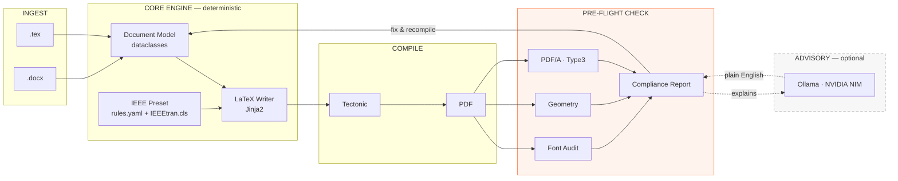
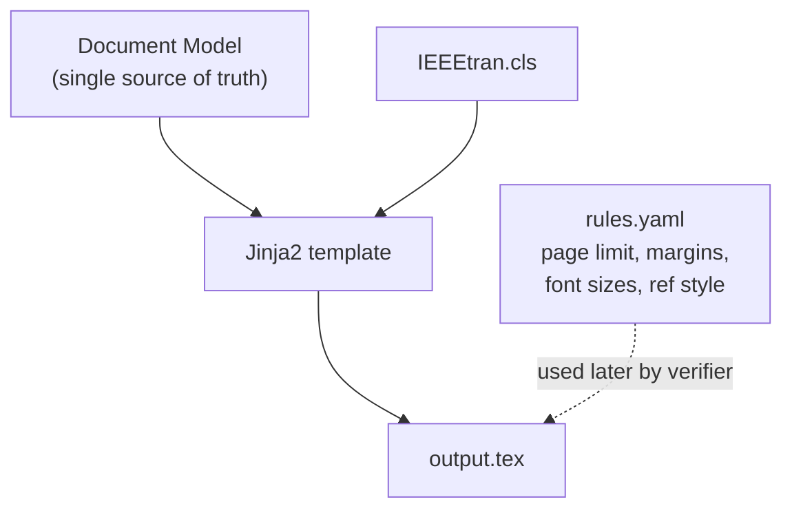
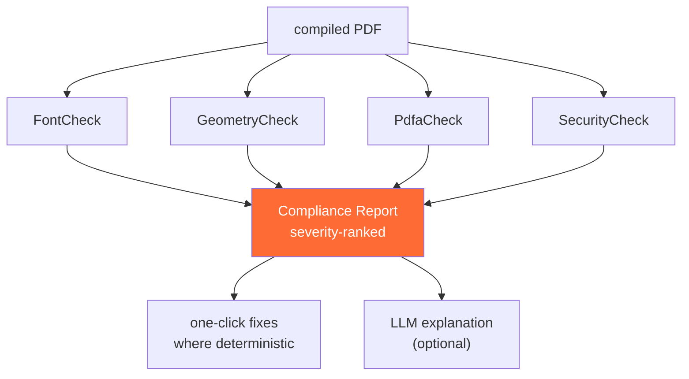
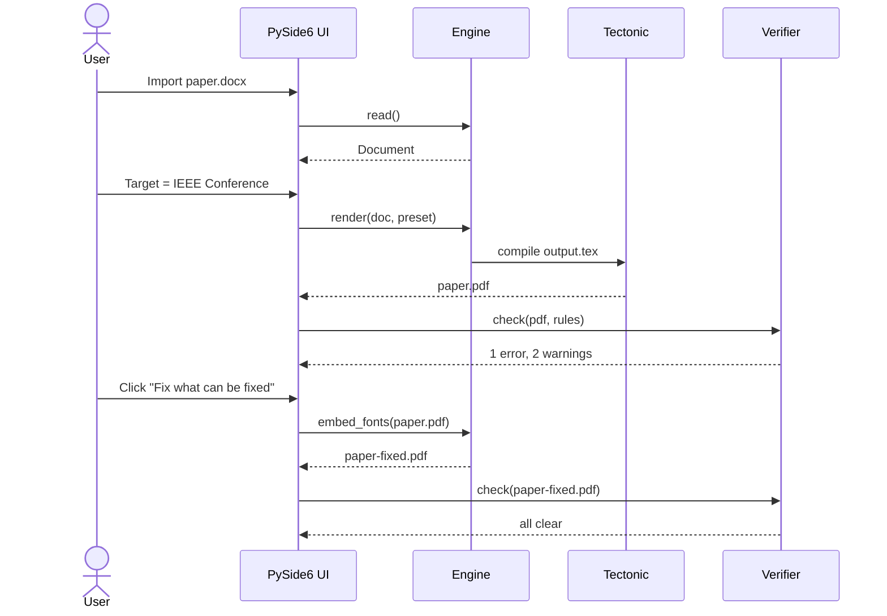

# 02 · System Architecture

## Design principle

> **Rules check. The model only explains.**

Every compliance decision in Prarup is made by deterministic code — geometry,
font tables, page counts. The language model never decides whether something is
compliant and never edits the document on its own. It translates a machine
verdict into readable English and, when asked, suggests options.

Disable the AI entirely and every check still runs. That is not a fallback mode;
it is the default.

---

## Full system diagram



The dashed box is the point of the diagram. The AI sits **beside** the pipeline,
never inside it. It is not built yet, and every check already runs without it.

---

## The four stages

### 1 · Ingest

Two readers, one output type. Both produce the same `Document` object, so nothing
downstream needs to know where the manuscript came from.

| Input | Path | Fidelity |
|---|---|---|
| `.tex` | Compiled as written | Lossless. The author's own preamble is kept, since it cannot be reliably separated from the body |
| `.docx` | pandoc → LaTeX fragment → IEEE template | Good. Images extracted with `--extract-media=.`; custom macros are detected and warned about |

PDF input is deliberately **out of scope for v1**. See
[07 · Scope](07-scope-and-timeline.md) for the reasoning.

### 2 · Core engine



A preset is two things: a **LaTeX class file** (how it renders) and a
**`rules.yaml`** (what counts as compliant). Splitting them is what lets us add a
new conference without touching Python — and what lets the LLM generate a draft
preset from a call-for-papers.

### 3 · Compile

**Tectonic**, run inside a `QThread` worker so the window never blocks.

- Self-contained: downloads only the packages the document actually uses
- Runs the correct number of passes automatically — no `latexmk` guesswork
- Users do **not** need a 5 GB TeX Live installation

*Planned, not built:* auto-compile debounced at roughly 800 ms of keyboard idle.
Today the user clicks **Build**.

### 4 · Pre-flight check



Each check is a plain function, `check_x(pdf_path) -> list[Issue]`, and
`run_all_checks` calls them in turn. Adding a new rule means one function and one
line. Built today: fonts, page count, security and bookmarks. PDF/A, margins and
caption placement are not built; see [11 · Compliance Rules](11-compliance-rules.md).

---

## Data flow, one full loop (as built; bundle export is not built yet)



---

## Module layout, as built

Flat, one file per job, as [14 · How To Build It](14-how-to-build.md) argues:

```
prarup/
├── models.py      Issue, Rules, Author, Document   (dataclasses)
├── checks.py      the compliance checks             (pure, no subprocess)
├── document.py    pandoc fragment → Document        (pure)
├── render.py      Document → IEEE LaTeX via Jinja2  (pure)
├── convert.py     .docx → LaTeX                     (runs pandoc)
├── compile.py     .tex → PDF                        (runs Tectonic)
├── fix.py         embed fonts                       (runs Ghostscript)
├── main.py        command line
├── gui.py         the window
├── presets/ieee.yaml
└── templates/ieee.tex.j2
tests/             105 tests, fixtures in tests/fixtures/
```

The proposal's nested packages (`ingest/`, `verify/`, `llm/` …) were never needed
at this size. `checks.py` is the spine: a test fails if it ever imports
`subprocess`, Qt or a network library.

---

**Previous:** [← 01 · Problem](01-problem.md) · **Next:** [03 · Features →](03-features.md)
