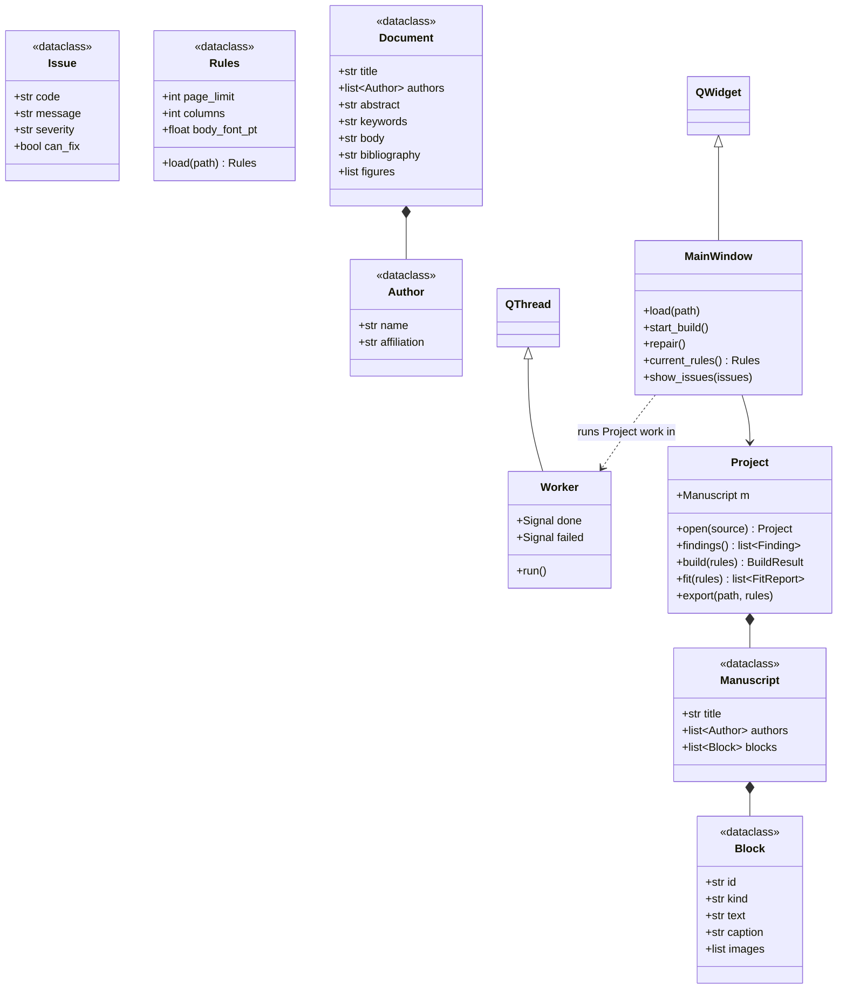

# 05 · Python Design

PC503 is a Python subject, so the object model is not incidental. It is part of
the deliverable. This document describes the structure that was **actually
built**, and why it is shaped this way.

> **Changed from the proposal.** The first version of this document designed
> three abstract base classes (`Reader`, `Check`, `LLMBackend`) before any code
> existed. When we built it, none of them earned their place: there was one
> reader per format, the checks were plain functions, and the LLM layer is not
> built yet. [14 · How To Build It](14-how-to-build.md) explains the rule we
> followed instead: *no abstraction until you have written the same thing twice.*

---

## What exists



Everything else is a **plain function**.

| File | Contents | Kind |
|---|---|---|
| `models.py` | `Issue`, `Rules`, `Author`, `Document`, `Graphic`, `Measured`, `Geometry`, `FigureChange`, `FitReport` | dataclasses; `Rules.load`, `Geometry.bounds` and two small properties are the only logic |
| `checks.py` | `check_fonts`, `check_page_count`, `check_security`, `check_bookmarks`, `check_figure_overflow`, `run_all_checks` | pure functions: PDF path in, list of `Issue` out |
| `frontmatter.py` | `split_front_matter`, `latex_to_plain`, `escape_latex` | pure string work: title, authors, abstract from a Word paper |
| `figures.py` | `find_graphics`, `resize`, `instrument` | pure string work: find and resize `\includegraphics` |
| `measure.py` | `measure`, `ocr_text_per_width` | reads the PDF, runs Tesseract |
| `fit.py` | `fit_paper`, `describe` | the figure fitter loop, runs Tectonic |
| `compile.py` | `compile_pdf` | runs Tectonic |
| `fix.py` | `embed_fonts` | runs Ghostscript |
| `pandoc.py` | `read`, `blocks_to`, `markdown_to_latex` … | runs pandoc, batched |
| `ingest.py` | `open_paper` | reads a paper into a Manuscript |
| `texsource.py` | `ieee_author_blocks`, `bibitems`, `bib_entries`, `preamble_extras` | pure string work on LaTeX source |
| `manuscript.py` | `Manuscript`, `Block` | dataclasses, saved as JSON |
| `renderer.py` | `render` | Manuscript → IEEE LaTeX |
| `analyze.py` | `analyze`, `Finding` | pure: what is missing |
| `images.py` | `inspect`, `findings`, `ai_likelihood`, `dhash` | image forensics |
| `project.py` | `Project` | the controller: open, edit, check, build, fit, export |
| `ui/` | `MainWindow`, `Outline`, editors, `Panels`, `Worker` | the desktop window |
| `main.py` | argparse command line | entry point |

---

## Why functions, not a `Check` class hierarchy

A check takes a PDF and returns problems. It holds no state between calls, so a
class would add a constructor and a `self` and nothing else.

```python
def run_all_checks(pdf_path, rules):
    issues = []
    issues += check_fonts(pdf_path)
    issues += check_page_count(pdf_path, rules)
    issues += check_security(pdf_path)
    issues += check_bookmarks(pdf_path)
    issues.sort(key=lambda issue: issue.severity != "error")
    return issues
```

Adding a rule is one function and one line here. That is the same extension
cost the class registry promised, without the registry.

---

## Where classes are genuinely used

| Class | Why it is a class |
|---|---|
| `Issue`, `Rules`, `Author`, `Document` | They hold data. `@dataclass` gives equality and a readable `repr`, which makes test failures easy to read. |
| `Rules.load` (classmethod) | An alternative constructor that reads YAML and **rejects unknown keys**, so a typo in a preset fails loudly. |
| `MainWindow(QWidget)` | Real inheritance: Qt requires it, and the window holds all its widgets as state. |
| `Worker(QThread)` | Real inheritance: runs any slow job (pandoc, Tectonic, the classifier) off the UI thread and reports back through Qt **signals**. |
| `Project` | A real stateful object: the open paper, its folder, its last build. The window and the command line both use it. |
| `UnreadablePdf`, `TectonicNotFound`, `PandocNotFound`, `ConversionFailed`, `GhostscriptNotFound`, `RepairFailed`, `FitFailed` | Custom exceptions, so each failure reaches the user as one clear sentence. |

---

## The one architectural rule, enforced by a test

`checks.py` must never touch the outside world: no `subprocess`, no Qt, no
network. `tests/test_layering.py` reads the source and fails if any of those
names appear. That keeps the checks fast, deterministic and trivially testable.

---

## Python concepts used, and where

| Concept | Where |
|---|---|
| `@dataclass`, `field(default_factory=list)` | `models.py` |
| `@classmethod` alternative constructor | `Rules.load` |
| Inheritance from a framework class | `MainWindow(QMainWindow)`, `Worker(QThread)`, `Outline(QTreeWidget)`, the editors (`QWidget`) |
| Signals and slots, worker thread | `Worker.done` / `.failed`, `Editor.changed`, `Outline.chosen`, `Panels.jump` |
| Custom exceptions, `raise ... from` | `checks.py`, `compile.py`, `pandoc.py`, `ingest.py`, `fix.py`, `fit.py` |
| `pathlib.Path` throughout | every module |
| `subprocess.run` with captured output | `compile.py`, `pandoc.py`, `fix.py`, `measure.py` |
| `@property` | `Measured.width`, `Measured.text_pt` |
| Closures | `fit_paper`'s `layout(t)` and `pages_at(t)` share its measurements |
| Binary search | `fit_paper`, over the shrink factor `t` |
| Regular expressions | `ingest.py` (captions, sections, abstract), `frontmatter.py` (names, markers), `texsource.py` (LaTeX source), `analyze.py` (citations, mentions), `figures.py` (graphics, environments) |
| Jinja2 with custom delimiters | `renderer.py` |
| `argparse` subcommands, exit codes | `main.py` |
| Type hints | function signatures |
| `pytest` fixtures, `tmp_path`, `monkeypatch`, `pytest-qt` | `tests/`, 160 tests |

---

## Not built yet

The optional LLM layer. When it is built, the plan is still that **rules check
and the model only explains**: the model would receive an `Issue` and return
text, and nothing in `checks.py` would reference it.

---

**Previous:** [← 04 · UI Design](04-ui-design.md) · **Next:** [06 · Tech Stack →](06-tech-stack.md)
