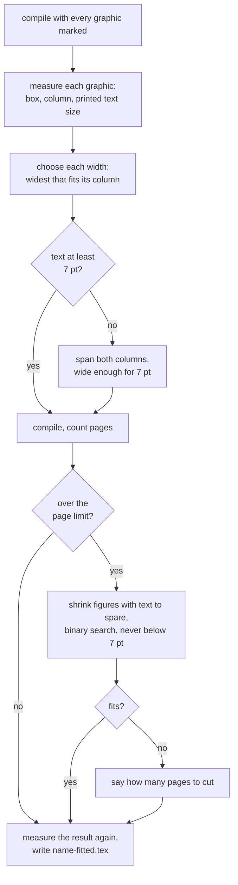

# 15 · The Figure Fitter

Fitting a figure into a column is easy. Fitting it **without making its text
unreadable** is the hard part, and no tool we know of does it. This document
explains how Prarup does.

```bash
poetry run prarup fit paper.docx      # or paper.tex
```

In the window: open the paper, **Build**, then **Fit figures**.

---

## The problem

A Word file stores every figure at a fixed size in inches, and pandoc passes it
through. An IEEE conference column is 3.5 in (252 pt) wide. A chart that was
5.8 in wide in Word runs straight across the second column.

The obvious fix, shrinking it to the column, shrinks the text inside it too. A
plot drawn 8 in wide with 10 pt labels, squeezed into one column, prints its
labels at 10 × 3.5 / 8 = **4.4 pt**. That is smaller than any text in the paper,
and unreadable in print.

This is not hypothetical. The IEEE IoT Journal article we tested has figure
labels printed at **2.4 to 5.2 pt**.

---

## The loop



### 1 · Measure: LaTeX tells us where everything went

Prarup compiles a copy of the paper with two additions, neither of which moves
anything on the page:

- **Page geometry.** One line in the preamble writes `\columnwidth`,
  `\textwidth`, the left margin and the column gap into the PDF's document
  info. Prarup reads the numbers LaTeX actually used, rather than assuming them.
- **Every graphic's box.** Each `\includegraphics` is wrapped in an invisible
  link named `prarup:fig:N`. The PDF driver records the link's rectangle, which
  is exactly the graphic's box on the page, and PyMuPDF reads it back. This works
  for bitmaps and vector figures alike.

### 2 · Measure: how big is the text inside the figure?

| Figure type | How | Accuracy |
|---|---|---|
| Vector (PDF from matplotlib, MATLAB, R) | The figure's own text spans, inside its box, read with PyMuPDF | Exact: 10 pt text in a 6 in plot shown 2 in wide measures 3.33 pt |
| Bitmap (PNG, JPG, as in most Word files) | Tesseract OCR on the image file. Word box height ÷ 0.96 for words with a tall letter and a tail ("Training"), ÷ 0.76 for the rest | Within about half a point, calibrated on matplotlib text from 6 to 14 pt at 100 to 300 dpi |

The figure's "text size" is the median of the smaller half of its words, not the
very smallest, so one superscript does not decide the verdict for a whole
figure.

**One number per figure.** Text scales with the figure, so Prarup keeps *text
size per point of width*. From one measurement it can predict the text size at
any width, without compiling again.

### 3 · Decide each width

With the smallest readable width `w_min = 7 pt ÷ (text per point of width)`:

| Case | Result |
|---|---|
| `w_min` fits in one column | Widest that fits the column (the author's own size if it already does) |
| `w_min` is wider than a column | Moves to `figure*`, across both columns |
| `w_min` is wider than the whole page | Kept inside its column and flagged: *re-export it with larger fonts* |
| No text could be measured | Only kept inside its column; never shrunk for the page limit |

A figure that already fits is left exactly as the author wrote it.

### 4 · The page limit: binary search

If the paper is now over the limit, every figure with text to spare shrinks
together: figure *i* gets `w_min_i + t × (w_i − w_min_i)`. At `t = 1` nothing has
shrunk; at `t = 0` every figure is at its smallest readable size.

- Prarup first tries `t = 0`. If even that is over the limit, it stops and says
  how far over (from how full the last page is): *"Still about 0.4 pages over…
  Cut text or figures."* It never goes below 7 pt.
- Otherwise it halves the interval five times, keeping the largest `t` that
  fits: 32 levels of precision in 5 compiles.

### 5 · Verify

The fitted paper is compiled with the markers once more and **measured again**.
The report shows the measured result, not the planned one. The demo test caught
exactly this: arithmetic said 7.0 pt, the measurement said 6.97 pt, because a
built figure comes out up to a point narrower than requested. Widths now aim
2 pt wide of the minimum.

---

## What it changes, and what it will not touch

The author's file is never changed. The result is `<name>-fitted.tex` beside it,
so relative image paths still resolve. For each figure it rewrites one thing:
the size options of `\includegraphics` become a single
`width=0.95\columnwidth` (or `\textwidth` across both columns). Other options
(`alt`, `trim`, `clip`, `page`) are kept.

It leaves alone, and says why in the report:

- several graphics in one figure (subfigures, side-by-side panels)
- a graphic inside `subfigure`, `minipage`, `tabular`, `\resizebox`, `\scalebox`
- a rotated graphic (`angle=`)
- a graphic outside any figure environment
- `\includegraphics` in a comment

---

## The report

```
Fig. 1 (page 2): 5.80 in, one column, text 6.9 pt  ->  5.91 in, both columns,
                 text 7.0 pt  (was 163 pt past its column)
Pages: 1 -> 2 (limit 6)
```

Moving a figure across both columns has a cost: IEEEtran places `figure*` at the
top of the next page. The report always shows the page count before and after.

---

## Settings

`presets/ieee.yaml`:

```yaml
min_figure_text_pt: 7.0
```

7 pt is **our choice, not an IEEE rule**: just under IEEE's 8 pt footnotes. A
default matplotlib figure (6.4 in wide, 10 pt text) printed one column wide
carries 5.5 pt text, so it fails this unless drawn smaller or moved across both
columns. Override per run with `prarup fit paper.tex --min-figure-text 6`.

---

## The overlap check that goes with it: GEOM-02

`checks.py` compares every image with the column widths recorded in the PDF and
reports any that runs past its column. A `figure*` centred over the whole text
block is wide on purpose and not reported. PDFs that Prarup did not build carry
no widths, so the check stays quiet on them rather than guessing.

---

## Files

| File | Job | Pure? |
|---|---|---|
| `figures.py` | Find `\includegraphics`, decide which are safe, rewrite widths, add the markers | Yes, string work |
| `measure.py` | Read boxes, geometry and text size from the PDF; OCR bitmaps | No, runs Tesseract |
| `fit.py` | The loop, and the report | No, runs Tectonic |

Tested by `tests/test_figures.py`, `test_measure.py`, `test_fit.py` and the demo
test in `test_end_to_end.py`. Every expected number in them is worked out by
hand from the plot's own text size and the IEEE geometry.

---

**Previous:** [← 14 · How To Build It](14-how-to-build.md) · **Home:** [README](../README.md)
