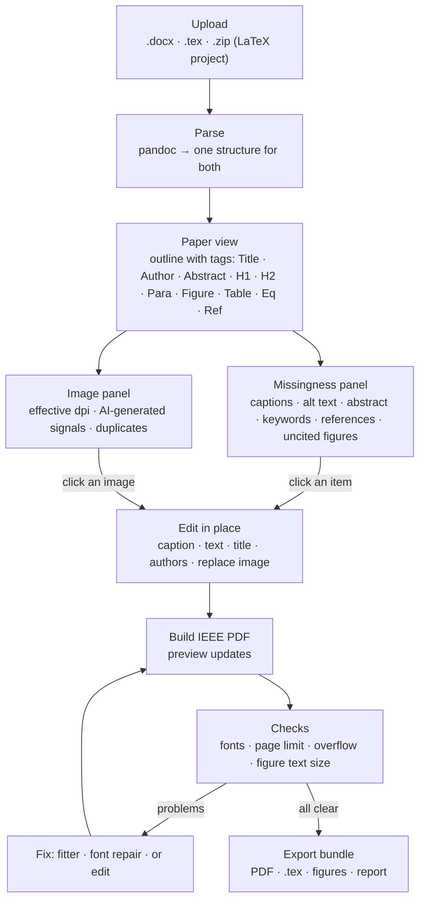
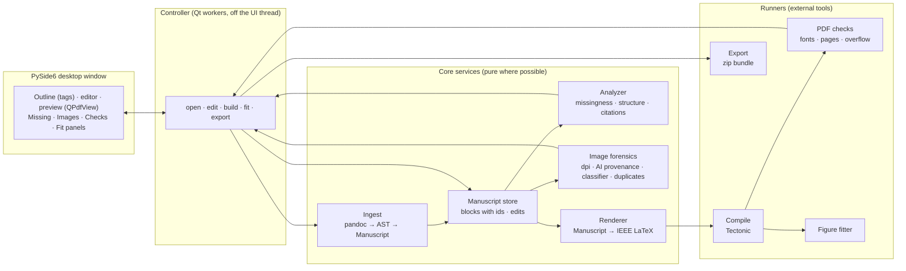
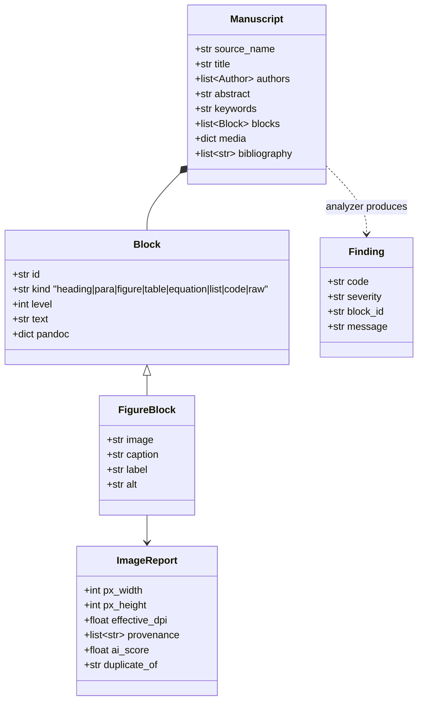

# 16 · Redesign: from checker to platform

Written 2026-11-15, after testing Prarup v0.9 on real papers for the first time.
The verdict: the individual pieces work in tests, but **a real user cannot get a
real paper through it.** This document is the audit, the first-principles
redesign, and the build plan.

---

## 1 · Audit: v0.9 on real papers

Three real IEEE conference papers, downloaded from arXiv as LaTeX source, and
the same papers converted to Word with pandoc.

| Paper | Input | What happened |
|---|---|---|
| arXiv 2402.05973 (6 pp, 7 figures) | `.tex` | Builds. **Fit made it worse**: moved 4 figures across both columns for readability, 7 → 8 pages against a 6-page limit |
| arXiv 2206.02043 (GLOBECOM 2022) | `.tex` | Builds. Figures print at **2.0 to 2.5 pt**; Build says nothing, Fit skips them (subfigures) |
| arXiv 2108.10748 (GLOBECOM 2021, 6 `\input` files) | `.tex` | **Does not compile**: written for pdfLaTeX (`inputenc`), Tectonic is XeTeX. User sees a raw TeX log. Fit cannot see figures inside `\input` files |
| 2402.05973 as Word | `.docx` | **Does not compile**: pandoc emits `\texorpdfstring` (needs hyperref) and `longtable` (illegal in two columns). Any Word file with a table or a symbol in a heading fails |
| 2206.02043 as Word | `.docx` | pandoc could not convert a custom maths macro |

Beyond crashes, the flow itself is wrong:

- **Nothing is editable.** The user sees a PDF and a list of problems, and must
  go back to Word or LaTeX to fix anything.
- **Nothing shows what is missing.** No list of captions, figures, tables,
  references, or which of them are absent.
- **A `.tex` is compiled with the author's preamble**, so every pdfLaTeX-only
  package is a hard failure.
- **No image checks** beyond fonts: resolution, AI-generated images and
  duplicates are not looked at.

---

## 2 · First principles: who lands, and what they need

**Who:** a student or researcher with a finished draft, in Word or LaTeX,
submitting to an IEEE conference this week.

**What they need, in order:**

1. Put the paper in, in whatever form it is in (Word, one `.tex`, or a LaTeX
   project with images).
2. See it as a **paper**, not as a file: title, authors, abstract, sections,
   figures, tables, references, each recognised and labelled.
3. See **what is missing or wrong**, in one place, before anything else.
4. **Fix it right there**: type the missing caption, replace the low-resolution
   image, add the abstract, without going back to Word.
5. See the IEEE PDF update.
6. Know it will pass: fonts, page limit, figure readability, image integrity.
7. Download the submission: PDF, LaTeX source, figures, and a report.

v0.9 only does 5 and part of 6.

---

## 3 · What similar tools do, and what we take

| Tool | What it does | What Prarup takes |
|---|---|---|
| **Paperpal Preflight** | Upload Word/PDF → 30 checks in groups (counts, references, disclosures, metadata, figures & tables, structure) → report → fixed file → free rechecks | **Grouped checklist report**, re-check loop, structure and metadata checks |
| **Imagetwin** | Image integrity for publishers: duplication, manipulation, plagiarism, **AI-generated** image detection, bounding boxes and confidence | **AI-image screening with a confidence, never a verdict**; **duplicate figure detection** |
| **SciSpace (Typeset)** | 20,000+ journal templates, edit sections, export Word/LaTeX/PDF | **Structured editor** over sections and figures; export |
| **IEEE PDF eXpress** | Pass/fail on the final PDF (fonts, PDF version) | Already have: font checks, done before submission |
| **Overleaf** | Edit source, live PDF | Side-by-side **edit → preview** |

What none of them do, and Prarup will: **readable figure sizing** (the fitter),
offline operation, and every check explained by a rule, not a model.

---

## 4 · The user journey



### The main window (PySide6)

```
┌──────────────────────────────────────────────────────────────────────────────────────┐
│ प्रारूप Prarup   paper.docx  ·  IEEE Conference      [Build]  [Fit figures]  [Export] │
├───────────────────────┬─────────────────────────────────┬────────────────────────────┤
│ OUTLINE               │ EDITOR                          │ PREVIEW (IEEE PDF)         │
│ [TITLE] Federated…    │ ┌ FIGURE 3 ────────────────────┐│                            │
│ [AUTH]  3 authors     │ │ [image]  accuracy.png        ││   ░░░░░░  ░░░░░░           │
│ [ABS]   Abstract      │ │ 1200×450 px · 171 dpi ⚠      ││   ░░░░░░  ▣▣▣▣▣▣           │
│ [H1] I. Introduction  │ │ AI signals: none found       ││                            │
│   [P] Federated…      │ │ Caption: [________________]  ││                            │
│   [FIG 1] ✓ caption   │ │   ⚠ missing                  ││                            │
│ [H1] II. System Model │ │ [Replace image]              ││                            │
│   [FIG 3] ⚠ no caption│ └──────────────────────────────┘│                            │
│   [TAB 1] ✓           │                                 │                            │
├───────────────────────┴─────────────────────────────────┴────────────────────────────┤
│ MISSING (4)  ⚠ Fig. 3 caption · ⚠ Keywords · ⚠ Fig. 5 never cited · ⚠ Ref [7] unused │
│ IMAGES (7)   ⚠ Fig. 3 171 dpi (< 300) · ⛔ Fig. 6 AI-generated (C2PA: DALL·E 3)      │
│ CHECKS       ✓ fonts · ✓ 6/6 pages · ✓ no overflow · ⚠ Fig. 2 text 4.1 pt           │
└──────────────────────────────────────────────────────────────────────────────────────┘
```

---

## 5 · Architecture

**A desktop application, built with PySide6.** A desktop GUI is a required
part of the PC503 project, and running locally is also what keeps an
unpublished manuscript on the author's machine.

One Python process, organised as services with narrow interfaces. Separate
processes (true microservices) would add deployment work and buy nothing for a
single-user tool; the boundaries below are where they would split if it ever
became a hosted service.



### The key decision: one structure for both inputs

pandoc reads **both** Word and LaTeX into the same document tree (its JSON
AST). Tested on the three papers above:

| Paper | Headers | Figures | Captions found | Tables | Equations | Citations | Title/authors/abstract |
|---|---|---|---|---|---|---|---|
| 2402.05973 | 12 | 7 | 7 / 7 | 0 | 103 | 12 | ✓ |
| 2206.02043 | 15 | 6 | 6 / 6 | 0 | 185 | 17 | ✓ |
| 2108.10748 (6 files) | 8 | 8 | **6 / 8** | 1 | 136 | 19 | ✓ |

So Prarup stops compiling the author's own preamble. It **regenerates** the
paper from the structure into its IEEE template. That removes the pdfLaTeX
failures, makes everything editable, and gives one place to check what is
missing. The cost: an author's custom LaTeX packages are not carried over.
pandoc expands simple `\newcommand` macros itself; anything it cannot read is
shown in the paper view as raw LaTeX, so nothing is silently dropped.

### The Manuscript model



Each block keeps its original pandoc node, so text the editor does not touch is
written back exactly as it was read.

---

## 6 · Missingness: what the Analyzer looks for

| Code | Missing or wrong | How it is found |
|---|---|---|
| META-01 | No title | Manuscript title empty |
| META-02 | No authors / author without affiliation | Author list |
| META-03 | No abstract | Abstract empty |
| META-04 | No keywords / index terms | Keywords empty |
| FIG-01 | Figure without a caption | Figure block, empty caption; or a bare image paragraph |
| FIG-02 | Figure never cited in the text | Figure label not referenced by any `\ref` / cross-reference |
| FIG-03 | Figure image missing | Image path does not resolve |
| TAB-01 | Table without a caption | Table block, empty caption |
| TAB-02 | Table never cited | as FIG-02 |
| REF-01 | No references section | No bibliography and no reference list |
| REF-02 | Citation with no matching reference | Cite key not in the bibliography |
| REF-03 | Reference never cited | Bibliography entry not cited |
| STR-01 | No Introduction / Conclusion | Heading text |

---

## 7 · Image forensics

### Effective resolution

The resolution that matters is the **printed** one: pixels ÷ printed inches.
A 1200 px image printed 3.5 in wide is 343 dpi; printed 7 in wide it is 171 dpi.
IEEE asks for at least 300 dpi for photographs and 600 for line art. Prarup
reports effective dpi per image at its printed width, and warns below 300.

### AI-generated images: three layers, strongest first

No single method is reliable, so Prarup reports evidence, layer by layer, and
says how strong each is.

| Layer | Signal | Strength | How |
|---|---|---|---|
| 1 · Declared provenance | **C2PA Content Credentials** manifest naming a generative tool or `c2pa.ai-disclosure`; IPTC `DigitalSourceType = trainedAlgorithmicMedia` in XMP | Decisive when present | `c2pa-python` to read and validate manifests; XMP read from the file |
| 2 · Tool fingerprints | PNG text chunks written by generators: Stable Diffusion (`parameters`), ComfyUI (`prompt`, `workflow`), Midjourney / DALL·E / Firefly in EXIF `Software` or XMP `CreatorTool` | Strong when present, easy to strip | PNG chunks and EXIF via Pillow |
| 3 · Classifier | A pretrained AI-vs-real image classifier, run locally | **Probabilistic.** Trained mostly on photos and art, not scientific figures; shown as a likelihood with that warning, never as a verdict | Optional install (`poetry install --with ai`, decided 2026-11-15), e.g. `Ateeqq/ai-vs-human-image-detector` (Apache-2.0) |

Absence of layers 1 and 2 proves nothing: metadata is stripped by screenshots
and by Word itself. The report says so.

### Duplicate figures

A perceptual hash per image flags the same figure used twice, including after
resizing or recompression (Imagetwin's most common finding).

---

## 8 · Test plan: real papers, made messy

Each of the three arXiv papers gets a Word version and a LaTeX version, and then
deliberate damage, so every check has something real to find:

| Damage | Expected finding |
|---|---|
| Delete two figure captions | FIG-01 ×2 |
| Delete the abstract and keywords | META-03, META-04 |
| Downscale one figure to 400 px wide | Low effective dpi |
| Insert an AI-generated image with its metadata intact | AI provenance found |
| Insert the same figure twice | Duplicate |
| Cite a reference that does not exist | REF-02 |
| A figure 6 in wide | GEOM-02, fixed by the fitter |

Every scenario is run **through the UI**, as a user would: upload, read the
missingness panel, fix in the editor, build, export, and the exported bundle is
checked. Screenshots go in the report.

---

## 9 · Build order

1. Ingest: pandoc AST → Manuscript, for `.docx`, `.tex` and `.zip`
2. Renderer: Manuscript → IEEE LaTeX that compiles (fixes `longtable`,
   `\texorpdfstring`, figures, tables)
3. Analyzer: missingness
4. Image forensics: dpi, AI layers 1 and 2, duplicates; classifier as an extra
5. Fitter policy: when readability and the page limit conflict, show both
   layouts ("readable, 8 pages" / "within 6 pages, Fig. 3 text 4.6 pt") and let
   the user pick
6. Desktop UI (PySide6): outline with tags, editor, panels, preview, styled
7. Export bundle
8. The messy-paper test plan, end to end through the UI

---

**Previous:** [← 15 · The Figure Fitter](15-figure-fitter.md) · **Home:** [README](../README.md)
