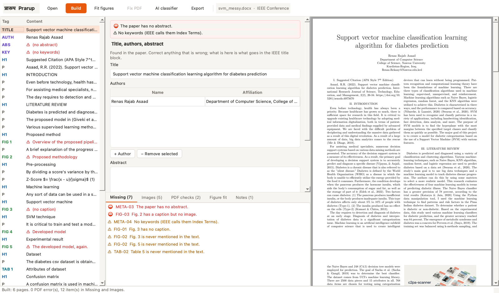
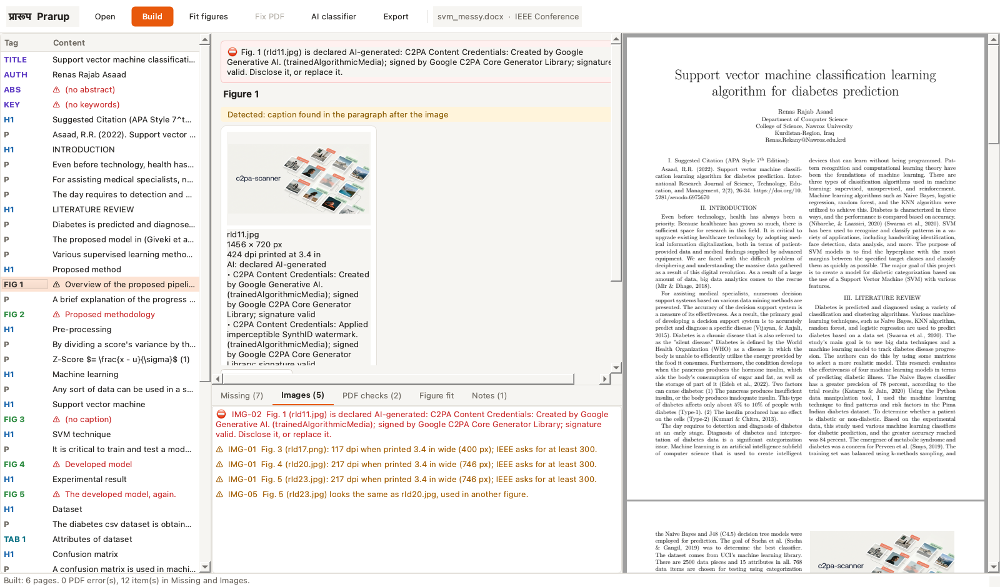
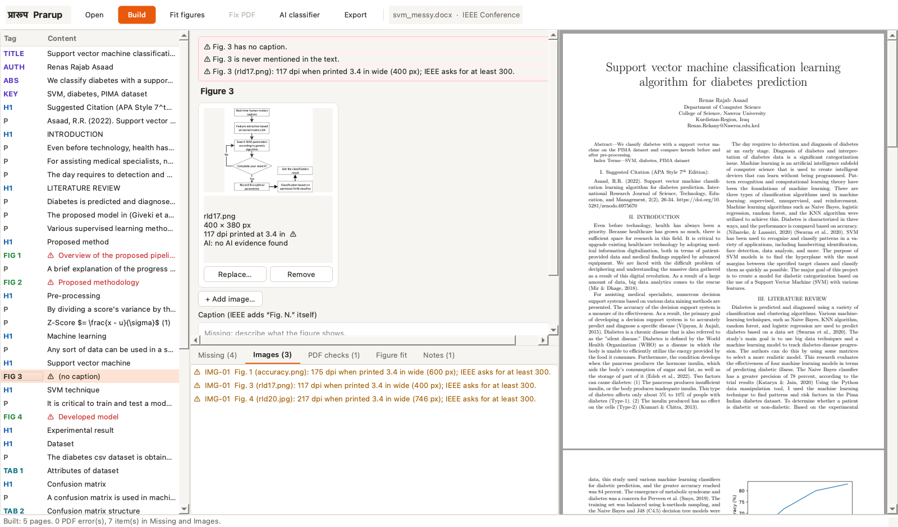
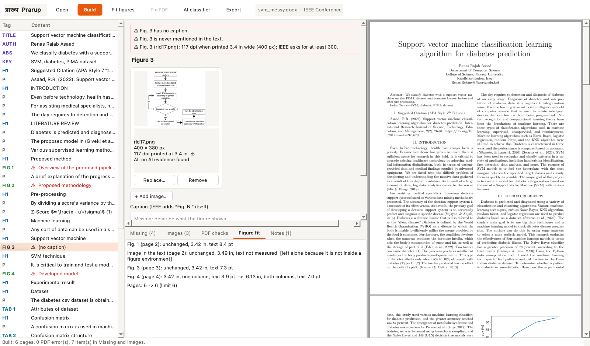

# 17 · Testing on Real Papers

What Prarup was tested on, what it found, and how each claim was measured.
Every number below comes from a run, not an estimate.

---

## The papers

| Paper | Form | Source | Licence | In the repo? |
|---|---|---|---|---|
| YOLO-based football analysis (Roy) | Word | Zenodo 16929566 | CC BY 4.0 | `tests/fixtures/real/` |
| ML for UAV and ground imagery (Sharp et al.) | Word | Zenodo 11105119 | CC BY 4.0 | `tests/fixtures/real/` |
| SVM for diabetes prediction (Asaad) | Word | Zenodo 6975670 | CC BY 4.0 | `tests/fixtures/real/` |
| BCS-FL, blockchain federated learning (Hafeez et al.) | LaTeX | arXiv 2402.05973 | arXiv licence | no, tested locally |
| UAV-aided multi-community FL (GLOBECOM 2022) | LaTeX + .bib | arXiv 2206.02043 | arXiv licence | no, tested locally |
| FL for UAV swarms (GLOBECOM 2021), 6 `\input` files | LaTeX + .bib | arXiv 2108.10748 | arXiv licence | no, tested locally |

arXiv sources may not be redistributed, so `tests/fixtures/latex_project/` is
our own small paper that reproduces every construct the three arXiv papers
broke on.

---

## Before and after

| | v0.9 | Now |
|---|---|---|
| Real inputs that compile | 2 of 5 | **6 of 6** |
| Title, authors, abstract recovered | typed by hand | **6 of 6**, with affiliations |
| Figures and captions recognised | no | every pattern found in the six papers |
| What is missing, shown | no | 21 kinds of finding, plus GEOM-03 on build (see doc 11) |
| Editable before building | no | every block |
| Unreadable figure text reported by Build | no | GEOM-03, measured |
| Image resolution, AI evidence, duplicates | no | yes |

### What broke v0.9, and the fix

| Real paper | Failure | Fix |
|---|---|---|
| All three Word papers | `longtable` (every Word table) is illegal in two columns; `\texorpdfstring` undefined | Tables written as `tabular`, spanning both columns when wide; the template defines what pandoc expects |
| GLOBECOM 2021 | `inputenc` for pdfLaTeX; Tectonic is XeTeX | Prarup rebuilds the paper in its own template and carries over only the author's safe maths packages and macros |
| GLOBECOM 2022 | `\mathds` from the author's `dsfont`; `align` inside `\[ \]` | Packages carried over; the nesting unwrapped, labels kept |
| BCS-FL | An image used outside any figure; wrong-case file name | Every image copied in; the case mismatch reported (it breaks on Linux) |
| BCS-FL (fitter) | Readable figures pushed the paper from 7 to 8 pages | Both layouts offered; the user chooses |

---

## Recognising structure in real Word papers

| Pattern, as found | Paper | Handled as |
|---|---|---|
| "Author(s):" label line, "Email:" line | YOLO | label skipped, email joined to the affiliation |
| Superscript-numbered affiliations (Sharp¹ … ¹ Northern Arizona University) | UAV | each author gets their numbered affiliation |
| Logo above the title | UAV | left out, noted |
| Abstract and keywords inside a layout table, spelt "A B S T R A C T" | SVM | read out of the table |
| No headings; sections as short bold paragraphs | SVM | headings |
| "Introduction:" and "Conclusion:" as plain lines | YOLO | headings |
| Caption as its own paragraph after the image, or as a block quote | SVM, UAV | joined to the figure |
| Table caption before the table, or after it | SVM | joined to the table |
| "Figures 4 a and b" over separate sub-images | UAV | one figure with sub-images |
| A caption whose image did not survive | SVM, UAV | a figure with no image (FIG-03) |
| Inline maths followed by "(2)" | SVM | an equation |
| "References" as a plain paragraph | all three | the reference list |

---

## AI-generated image detection, measured

| Image | What it is | Declared (C2PA/IPTC) | Generator traces | Classifier |
|---|---|---|---|---|
| `gemini_c2pa.jpg` | Gemini, Google-signed C2PA | **found**: "Created by Google Generative AI", SynthID applied | | 1.00 |
| `sd_parameters.png` | Stable Diffusion, settings kept | | **found**: Steps 30, Euler a, seed | 1.00 |
| `ai_stripped_elf.png` | Stable Diffusion, metadata stripped | none | none | 1.00 |
| `ai_stripped_android.png` | AI image, metadata stripped | none | none | 1.00 |

The classifier (`Ateeqq/ai-vs-human-image-detector`, optional install) was
then run on all 26 bitmap figures of five real papers:

| Kind of figure | Count | Scored ≥ 0.80 (false alarm) |
|---|---|---|
| Charts, diagrams, logos | 20 | **4** (0.85 to 1.00) |
| Photos | 6 | 0 (all ≤ 0.44) |

So the classifier is run only on photo-like images. A chart is recognised
when its 8 most common colours cover at least 90% of its pixels: measured
0.94 to 1.00 for the charts and logos, 0.47 to 0.89 for photos and AI art.
With that rule, all four false alarms are excluded and all four AI images
are still classified. The window and the report say why a chart was not
classified, and never call a classifier score proof.

---

## Damaged papers, fixed through the window

`tools/make_messy.py` damages two real Word papers and our LaTeX project
(see `tests/fixtures/messy/README.md`). `tests/test_messy.py` opens each in
the window, checks every damage is listed, fixes it with the editors, builds
and exports. Every damage in that README's table is found, and every one is fixed.

The test found three bugs in Prarup, now fixed: a citation like [99] in an
author-year paper was not checked, the abstract was not scanned for
citations, and that problem opened the title instead of its paragraph.

| 1 · Opened: what is missing | 2 · The AI image, with Google's signed evidence |
|---|---|
|  |  |
| **3 · Fixing a figure: caption, 117 dpi** | **4 · Figures fitted: Fig. 4 from 3.9 pt to 7.0 pt** |
|  |  |

Regenerate the screenshots with `poetry run python tools/walkthrough.py`.

---

## Honest limits

- **Author detection** covers the layouts above. A layout not yet seen may
  put a name in the wrong field; the title-block editor shows what was found
  so it can be corrected before building.
- **Custom LaTeX** that pandoc cannot read appears as a raw block in the
  outline; packages that change page layout are deliberately not carried over.
- **OCR text size** is within about half a point on clean plots; dense
  screenshots can read lower.
- **AI detection** cannot see a stripped AI image except through the
  classifier, and the classifier is not used on charts.

---

**Previous:** [← 16 · Redesign](16-redesign.md) · **Home:** [README](../README.md)
